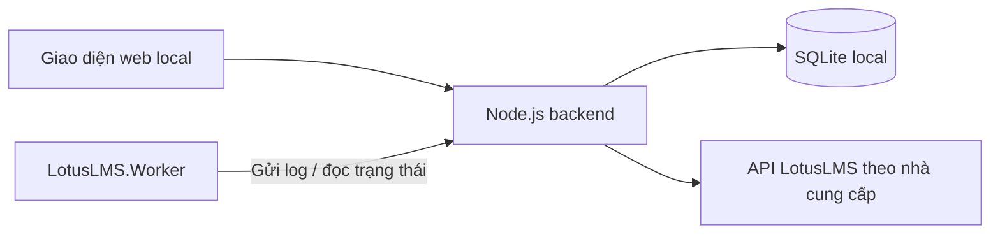

# Client quản lý tài khoản và Worker LotusLMS

Ứng dụng local dùng Node.js phục vụ cả backend API và giao diện web, lưu dữ liệu
bằng SQLite. Giao diện gồm bảng tài khoản, nhật ký worker, cấu hình proxy và
modal đọc response LMS raw.

## Chạy ứng dụng

Yêu cầu Node.js 24 trở lên. Từ thư mục repository:

```bash
cp .env.example .env
# Đặt CLIENT_USERNAME và CLIENT_PASSWORD trong .env.
cd client
npm ci
npm start
```

`npm start` và `npm run dev` tự đọc `.env` ở thư mục gốc repository; biến môi
trường có sẵn được ưu tiên. Client yêu cầu `CLIENT_USERNAME` và `CLIENT_PASSWORD`
không rỗng khi khởi động. Không có tài khoản/mật khẩu đăng nhập mặc định.
Mở giao diện sẽ vào màn hình đăng nhập; backend đối chiếu hai giá trị này và
cấp phiên 12 giờ bằng cookie HttpOnly/SameSite=Strict. Nút **Đăng xuất** hủy
phiên ngay. Restart server hoặc đổi thông tin trong `.env` rồi restart sẽ yêu
cầu đăng nhập lại. Đặt `CLIENT_SESSION_SECURE=true` khi truy cập bằng HTTPS;
để `false` với localhost/SSH tunnel/HTTP trong mạng riêng.

Giao diện và API quản trị cùng yêu cầu đăng nhập. Worker tiếp tục dùng khóa
bootstrap/API key riêng; không cần user/pass quản trị. Các kiểm tra nghiệp vụ
cũ có thể truyền `adminAuth: null` trực tiếp cho factory `createApp` trong
fixture; entrypoint và Docker luôn dùng cấu hình đăng nhập bắt buộc từ môi trường.

Mở `http://127.0.0.1:3100`. `npm run dev` dùng chế độ watch; `npm test` chạy kiểm
thử offline, `npm run check` kiểm tra cú pháp. Dữ liệu được tạo tự động ở
`client/data`; không có tài khoản hoặc mật khẩu mẫu được thêm vào database.

Cấu hình tùy chọn qua biến môi trường: `PORT` (3100), `CLIENT_HOST`
(`127.0.0.1`), `CLIENT_DATA_DIR` (đường dẫn thư mục dữ liệu),
`LMS_YENTHUY_API_URL`, `LMS_TRUONGSON_API_URL`. Hai URL LMS mặc định theo cấu hình
hiện tại của repository. Proxy được nhập và lưu trên trang “Cấu hình proxy”.

## Phạm vi

| Tính năng | Kết quả cần có |
| --- | --- |
| Tạo thông tin chung | Lưu căn cước, mật khẩu, nhà cung cấp, trạng thái và tên worker |
| Sửa thông tin | Cập nhật tài khoản; để trống mật khẩu trên form sửa sẽ giữ mật khẩu cũ |
| Thay đổi trạng thái | Chuyển giữa “Treo” và “Dừng treo” |
| Nhận log worker | Worker gửi log về backend, SQLite lưu theo tài khoản |
| Xem chi tiết tài khoản | Đăng nhập LMS, chọn chương trình học, hiển thị response danh sách khóa học dạng JSON trong modal |
| Cấu hình proxy | Lưu nhiều proxy HTTP/HTTPS/SOCKS5, kiểm tra IP và chọn một cấu hình cho từng account |
| Bảng quản lý account | Tìm kiếm, lọc, phân trang; tạo, sửa, chọn proxy, đổi trạng thái, mở chi tiết và xem log |

## Kiến trúc



- Backend Node.js phục vụ API tại `/api` và giao diện HTML/CSS/JavaScript cùng origin.
- Giao diện gọi backend; backend quản lý mật khẩu và phiên đăng nhập LMS.
- SQLite đặt tại `client/data/client.sqlite`.
- Cổng local mặc định: `http://127.0.0.1:3100`.
- Worker .NET có adapter gửi log và đọc trạng thái, mặc định tắt.

## Cấu trúc triển khai

```text
client/
├── docs/                   # Tài liệu tính năng, API và dữ liệu
├── src/
│   ├── server/
│   │   ├── index.js        # Khởi chạy HTTP server
│   │   ├── app.js          # Route API và static assets
│   │   ├── store.js        # SQLite, tài khoản, log, proxy và mã hóa
│   │   ├── lms.js          # Provider, login, cookie/session, proxy
│   │   └── signing.js      # Ký request, đối chiếu fixture C#
│   └── public/             # Giao diện HTML/CSS/JavaScript do Node.js phục vụ
└── data/                   # SQLite và khóa local; được bỏ qua trong Git
```

Giao diện dùng JavaScript trên trình duyệt; Node.js phục vụ giao diện và xử lý
mọi request LMS ở backend. SQLite dùng module tích hợp
[`node:sqlite`](https://nodejs.org/docs/latest-v24.x/api/sqlite.html); HTTP/proxy
dùng [`undici ProxyAgent`](https://github.com/nodejs/undici/blob/main/docs/docs/api/ProxyAgent.md).

## Chọn proxy cho từng account

1. Vào **Cấu hình proxy** → **Thêm**. Có thể dán chuỗi nhà cung cấp
   `host:port:username:password` vào **Nhập nhanh từ nhà cung cấp** rồi nhấn
   **Tách thông tin proxy**, hoặc nhập host/port và thông tin xác thực riêng.
   Chuỗi không có giao thức được chuẩn hóa thành HTTP và lưu URL cùng thông tin xác thực riêng.
   Với SOCKS5, chọn giao thức **SOCKS5**, nhập Host và **SocksPort** của nhà cung cấp;
   có thể dán trực tiếp `socks5://160.250.166.18:11548` rồi tách thông tin.
   Để trống username/password nếu không cần xác thực. Client và Worker đều dùng
   SOCKS5 cho kết nối LMS; tên miền đích được phân giải qua proxy.
   Với IPv6, đặt địa chỉ trong ngoặc vuông, ví dụ
   `[2001:db8::1]:8080:user:pass`; dấu `:` trong mật khẩu được giữ nguyên.
   Nhập ngày hết hạn (nếu có), bật rồi lưu.
2. Vào **Tài khoản** → **Sửa** (hoặc thêm account mới).
3. Chọn cấu hình trong trường **Proxy** → **Lưu thay đổi**.

Bấm **Run/Treo** → chọn kết nối → **Tải chương trình** → chọn chương trình học
cần chạy → **Chạy tài khoản**. IID và tên chương trình được lưu vào account,
đồng thời trả cho Worker qua API danh sách/claim/heartbeat. Hủy modal không lưu. Danh sách chỉ
hiển thị proxy đang bật và còn hạn; ngày hết hạn có màu xanh/vàng/đỏ theo trạng
thái (vàng khi còn tối đa 3 ngày). Proxy hết hạn vẫn hiện trong trang quản lý
để gia hạn. Ngày hết hạn tính đến hết ngày theo giờ Việt Nam; để trống nghĩa
là chưa đặt hạn.

Chọn **Kết nối trực tiếp** để bỏ gán proxy. Bảng account hiển thị proxy đã chọn.
Proxy đang tắt không được gán mới và chặn đăng nhập của account đang sử dụng nó.
Muốn xóa cấu hình, gỡ khỏi các account trước. Mỗi account chọn một proxy; có thể
chia sẻ một cấu hình giữa nhiều account.

Lựa chọn áp dụng cho xem chi tiết LMS và Worker có `Client:Enabled=true`.
Khi thay đổi proxy lúc Worker đang chạy, Worker dừng ở lần đọc control kế tiếp
(tối đa khoảng 5 giây khi API phản hồi bình thường); khởi động lại để dùng proxy
mới. Worker độc lập tiếp tục dùng `Http:Proxy` của .NET.

Database cũ được sao lưu tự động trước khi chuyển proxy chung thành danh sách;
proxy cũ đang bật sẽ được gán cho các account hiện có. Chi tiết trong
[DATABASE.md](docs/DATABASE.md).

## Thư viện kết nối .NET

[`LotusLMS.Client`](../LotusLMS.Client/README.md) chứa `ILotusClient`, DTO và HTTP
transport dùng lại cho ứng dụng .NET khác. Worker đã dùng thư viện này cho nhận
account, heartbeat, log và finish. Không đổi API backend hoặc dữ liệu SQLite.

## Kết nối Worker .NET và nhận học viên

### Chạy Client và Worker V2 bằng Docker Compose

Để deploy trên server bằng image có sẵn từ GHCR, dùng bộ Compose độc lập và
hướng dẫn trong [`deploys/README.md`](../deploys/README.md). Workflow
[`publish-images.yml`](../.github/workflows/publish-images.yml) kiểm tra,
build và publish image client/worker cho Linux amd64 và arm64.

Trong thư mục gốc repo, tạo file cấu hình, thay bootstrap key bằng giá trị được
tạo ở mục **Worker & khóa**, rồi build và chạy hai service:

```bash
cp .env.example .env
openssl rand -hex 32
# Dán kết quả vào WORKER_REGISTRATION_KEY trong .env
# Đặt CLIENT_USERNAME và CLIENT_PASSWORD cho màn hình đăng nhập.
docker compose build
docker compose up -d
```

Mở giao diện tại `http://127.0.0.1:3100`. Đổi cổng bằng `CLIENT_PORT` trong
`.env`. Client lưu SQLite và API key lane trong Docker volume
`lotuslms-client-data`; `docker compose down` không xóa volume này. Không commit
`.env`. Sau khi thay bootstrap key, cập nhật biến đó rồi tạo lại container bằng
`docker compose up -d --force-recreate`.

Sau khi nhấn **Run/Treo**, account vào hàng chờ. Worker gọi API danh sách, chọn
một học viên rồi xác nhận nhận việc. Backend khóa account trong SQLite và ghi
tên Worker thực tế; Worker khác nhận cùng account sẽ nhận `409 ACCOUNT_CLAIMED`.
Bảng account tự làm mới mỗi 5 giây, hiển thị Chờ Worker / Đã tiếp nhận / Đang xử
lý / Đang dừng cùng log gần nhất. “Xem log” xem lịch sử từng lượt chạy.

Đăng ký tên Worker yêu cầu khóa bootstrap mà Client API đọc từ biến môi trường
`WORKER_REGISTRATION_KEY`:

Có thể tạo khóa 256-bit tại mục **Worker & khóa** trong giao diện Client. Khóa
được tạo trong trình duyệt, không gửi hoặc lưu ở Backend. Sao chép khóa rồi đặt
cùng một giá trị cho `WORKER_REGISTRATION_KEY` của Backend và
`Worker:RegistrationApiKey` của Worker; khởi động lại Backend sau khi thay đổi
biến môi trường. Không tải lại trang trước khi sao chép vì khóa chỉ tồn tại tạm
trong trang đang mở.

```bash
export WORKER_REGISTRATION_KEY='<secret tối thiểu 32 ký tự>'
npm start
```

Gọi API đăng ký thủ công cần gửi cùng khóa bootstrap:

```bash
curl http://127.0.0.1:3100/api/workers \
  -H "Authorization: Bearer $WORKER_REGISTRATION_KEY" \
  -H 'Content-Type: application/json' \
  -d '{"workerName":"worker-node-01"}'
```

Tên mới trả `201`; đăng ký lại với khóa bootstrap hợp lệ trả `200` và cùng API
key lane đã tạo trước đó. Worker V2 tự đăng ký các tên lane từ `WorkerName` và
`MaxConcurrentAccounts`; chỉ cần cấu hình cùng secret trong
`Worker:RegistrationApiKey` của Worker. API key từng lane chỉ được trả cho
khóa bootstrap hợp lệ và được giữ riêng trong `client/data/worker-api-keys.json`
với quyền truy cập local. Không đưa key vào Git.

Worker V2:

```bash
dotnet user-secrets set "Worker:WorkerName" "worker-v2" --project LotusLMS.Worker.V2
dotnet user-secrets set "Worker:MaxConcurrentAccounts" "5" --project LotusLMS.Worker.V2
dotnet user-secrets set "Worker:RegistrationApiKey" "$WORKER_REGISTRATION_KEY" --project LotusLMS.Worker.V2
```

Worker không cần nhập căn cước/mật khẩu hoặc nhà cung cấp; claim thành công trả
thông tin account và provider. Worker đọc `proxyId` từ chi tiết account rồi lấy
proxy qua `/api/proxies/:proxyId` với quyền sở hữu lượt chạy. Các cấu hình
`Client__WorkerName`/`Client__ApiKey` dưới đây áp dụng cho worker client cũ,
không phải Worker V2.

```text
Client__Enabled=true
Client__BaseUrl=http://127.0.0.1:3100
Client__WorkerName=worker-node-01
Client__ApiKey=<key lấy khi đăng ký Worker>
Client__AccountId=
```

Bỏ trống `AccountId` để tự lấy account đầu tiên có sẵn; có thể đặt UUID để chỉ
nhận một học viên cụ thể. Một tiến trình xử lý một account rồi thoát; dùng bộ
quản lý tiến trình nếu cần tự khởi động lại để nhận học viên tiếp theo. Chọn
`Worker:Mode` như luồng hiện có; mặc định `Idle` chỉ kiểm tra kết nối và gửi log.

Worker gửi heartbeat mỗi 5 giây, giữ quyền nhận 30 giây. Mất điều khiển hoặc
mất quyền sở hữu sẽ chặn request LMS mới, hủy request đang chạy và dừng host.
Backend chỉ đưa account đang Treo về hàng chờ khi hết lease hoặc nhận xác nhận
dừng. Không sửa thông tin account khi Worker còn giữ lượt chạy; dừng và chờ xác
nhận trước. Proxy hết hạn vẫn bị chặn như trước.

Log tự động lấy từ ILogger, kèm accountId, workerName và runId. Worker chỉ được
gửi log cho lượt mình sở hữu; eventId chống ghi trùng. Hàng đợi log memory tối
đa 5.000 sự kiện, không tồn tại sau khi tắt tiến trình. Bật tính năng này yêu cầu
Worker được build lại để dùng hợp đồng claim/heartbeat mới. `Client__Enabled=false`
giữ chế độ Worker độc lập.

```bash
dotnet run --project LotusLMS.RequestSigning.Tests -- --worker-client-only
```

Sau khi build solution, chạy `npm run test:worker` trong `client` để kiểm tra
Worker thật ở chế độ Idle nhận học viên và gửi log vào SQLite, không gọi LMS.
Chi tiết request/response: [WORKER_QUEUE.md](docs/WORKER_QUEUE.md).

## Đọc tài liệu

1. [Đặc tả tính năng, giao diện và nghiệm thu](docs/FEATURES.md).
2. [Hợp đồng API client và luồng gọi LMS](docs/API.md).
3. [Thiết kế dữ liệu và lưu trữ local](docs/DATABASE.md).
4. [Schema SQLite](docs/schema.sql).

## Mã nguồn tham chiếu

- [Các API đăng nhập, chương trình học và khóa học](../LotusLMS.Api/LotusLmsApiClient.cs).
- [Cấu hình tenant và API](../LotusLMS.Api/LotusLmsOptions.cs).
- [Thuật toán ký request](../LotusLMS.RequestSigning/README.md).
- [Fixture đối chiếu chữ ký](../LotusLMS.RequestSigning.Tests/Fixtures/cryptojs-vectors.json).
- [Fixture đối chiếu client sync token](../LotusLMS.RequestSigning.Tests/Fixtures/client-sync-vectors.json).

Các thông số LMS trong tài liệu được đối chiếu với mã nguồn hiện tại. URL API
được cấu hình phía backend theo nhà cung cấp để có thể cập nhật khi triển khai.

## Worker V2 tự nhận account

Worker V2 nhận một account Treo, gửi log tiếp nhận và duy trì heartbeat. Khi dừng
account hoặc proxy hết hạn, Worker giải phóng lượt rồi tiếp tục hàng chờ. Giai
đoạn này chuẩn bị context chương trình học, chưa chạy học/ôn luyện. Cấu hình API
key, tên Worker và debug VS Code: [LotusLMS.Worker.V2/README.md](../LotusLMS.Worker.V2/README.md).

Kiểm thử tích hợp bằng backend và SQLite tạm (build Worker V2 trước):

```bash
npm run test:worker-v2
```
