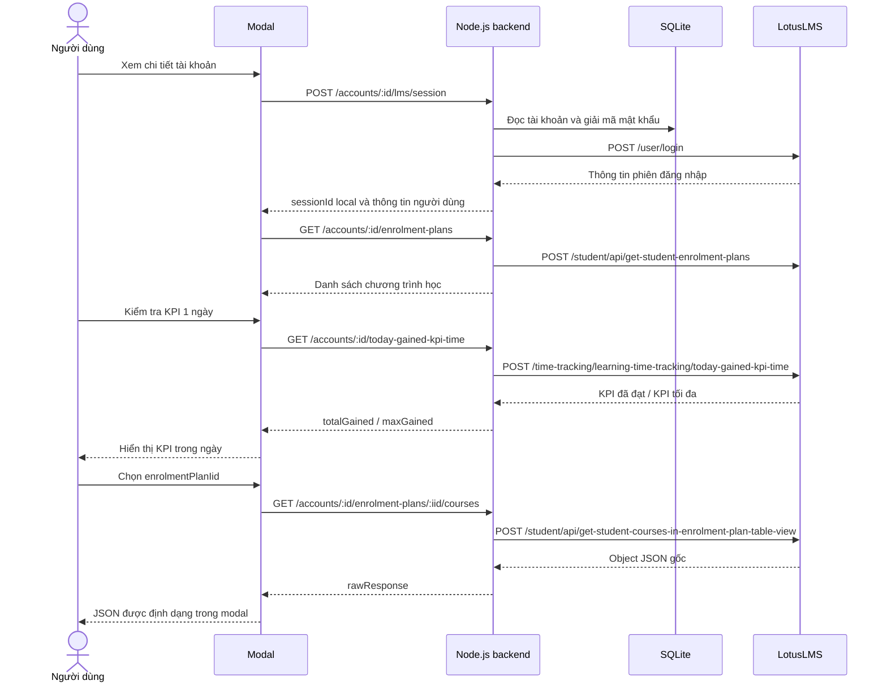

# Đặc tả tính năng client

## 1. Thông tin chung của tài khoản

| Trường trên giao diện | Trường API | Quy tắc |
| --- | --- | --- |
| Căn cước | `identityNumber` | Chuỗi đúng 12 chữ số, giữ nguyên số 0 đầu; dùng làm tên đăng nhập LMS |
| Mật khẩu | `password` | Bắt buộc khi tạo; không tự trim vì khoảng trắng có thể là một phần mật khẩu |
| Nhà cung cấp | `provider` | `yenthuy` hoặc `truongson` |
| Trạng thái | `status` | `running` hiển thị “Treo”; `stopped` hiển thị “Dừng treo” |
| Proxy | `proxyId` | Chọn một cấu hình proxy đang bật hoặc “Kết nối trực tiếp” |
| Giáo viên quản lý | `managingTeacher` | Text tự nhập, tùy chọn, tối đa 200 ký tự; có thể sửa khi Worker đang chạy |
| Tên worker | `workerName` | Tùy chọn khi tạo, trim, tối đa 100 ký tự; cập nhật tên thực tế khi Worker tiếp nhận |

Một cặp `(provider, identityNumber)` chỉ có một bản ghi. Cùng căn cước có thể có
tài khoản riêng ở hai nhà cung cấp. Khi tạo mới, trạng thái mặc định là
`stopped`; người dùng có thể chọn `running` ngay trên form.

Backend tự sinh `id` và `deviceUuid` bằng UUID. `deviceUuid` được giữ lại trong
SQLite để dùng cho các phiên xem chi tiết của tài khoản; không cần ô nhập GUID.

`status` thể hiện trạng thái người dùng yêu cầu. Chỉ việc đổi trường này chưa
xác nhận tiến trình worker đã chạy hoặc dừng. Log từ worker là nguồn thông tin
về việc worker đã nhận và thực hiện yêu cầu.

## 2. Màn hình danh sách

Các cột: Căn cước, Nhà cung cấp, Trạng thái, Giáo viên quản lý, Tên worker, Proxy, Cập nhật lúc, Thao tác.
Thao tác trên mỗi dòng gồm “Sửa”, “Treo”/“Dừng treo”, “Xem chi tiết” và “Xem log”.
Mật khẩu không xuất hiện trong danh sách, response tài khoản hoặc log.

Đầu trang có nút “Thêm tài khoản”, ô tìm theo căn cước/tên worker và bộ lọc nhà
cung cấp/trạng thái. Danh sách có phân trang, mặc định 20 dòng/trang.

Đây là bảng quản lý account chính. Có trạng thái đang tải, chưa có tài khoản,
không tìm thấy theo bộ lọc và lỗi tải dữ liệu. Nhãn “Treo”/“Dừng treo” dùng màu
và chữ; trạng thái không chỉ phân biệt bằng màu. Nút sửa/chi tiết/log giữ đúng
`accountId` của dòng sau khi tìm kiếm hoặc chuyển trang. Bảng cuộn ngang trên
màn hình nhỏ; thao tác và phân trang vẫn sử dụng được bằng bàn phím.

Phần tổng quan hiển thị số tài khoản, số đang treo và số tiến trình Worker đang giữ lượt chạy. Mật
khẩu không được trả về hoặc hiển thị trong bảng. Trang có mục “Cấu hình proxy”
riêng, hiển thị proxy đang bật/tắt và địa chỉ kết nối.

## 3. Tính năng 1 — Tạo thông tin chung

1. Người dùng bấm “Thêm tài khoản”.
2. Mở form thông tin chung, gồm lựa chọn proxy đã lưu.
3. Frontend kiểm tra dữ liệu và gọi `POST /api/accounts`.
4. Backend kiểm tra lại dữ liệu, mã hóa mật khẩu rồi ghi SQLite.
5. Thành công: đóng form, tải lại trang danh sách và hiển thị tài khoản mới.

Lỗi nhập liệu hiển thị tại trường tương ứng. Trùng căn cước trong cùng nhà cung
cấp hiển thị thông báo rõ và giữ dữ liệu đang nhập.

Việc lưu tài khoản không tự đăng nhập LMS. Tính hợp lệ của thông tin LMS được
kiểm tra khi người dùng mở chức năng xem chi tiết.

## 4. Tính năng 2 — Sửa thông tin

1. Bấm “Sửa” để mở form đã điền căn cước, nhà cung cấp và tên worker.
2. Ô mật khẩu để trống, ghi chú “Để trống để giữ mật khẩu hiện tại”.
3. Frontend bỏ trường `password` khỏi payload nếu ô này để trống.
4. Gọi `PATCH /api/accounts/:accountId`.
5. Backend kiểm tra dữ liệu, lưu thay đổi và trả thông tin tài khoản đã cập nhật.

Nếu sửa thông tin tài khoản hoặc đổi proxy, backend hủy phiên xem chi tiết LMS
cũ của tài khoản. Lần xem tiếp theo đăng nhập bằng dữ liệu mới. Khi đổi nhà cung
cấp, backend tự tạo `deviceUuid` mới cho nhà cung cấp mới.

Trạng thái được cập nhật qua thao tác “Treo”/“Dừng treo” riêng để dễ nhận biết.

## 5. Tính năng 3 — Thay đổi trạng thái

- Bấm Run/“Treo” mở danh sách chọn proxy còn hạn; xác nhận gửi `PATCH /api/accounts/:accountId/status` với `status=running` và `proxyId` đã chọn.
- Bấm “Dừng treo” gửi cùng endpoint với `status=stopped`.
- Trong lúc lưu, vô hiệu hóa nút của dòng đang xử lý.
- Chỉ cập nhật nhãn trên giao diện khi backend xác nhận đã lưu.
- Gửi lại cùng trạng thái trả thành công và giữ nguyên giá trị hiện tại.
- Đổi trạng thái không xóa thông tin tài khoản hoặc log.

Run đưa account vào hàng chờ. Worker đọc `GET /api/worker/accounts`, xác nhận
`POST /api/worker/accounts/:id/claim` với tên Worker, mã tiến trình và mã request.
Backend khóa trong transaction, mỗi account chỉ có một lượt đang hoạt động.
Worker nhận thông tin đăng nhập, nhà cung cấp và proxy sau khi claim thành công.
Không cần nhập thủ công học viên vào cấu hình Worker.

Worker gửi heartbeat mỗi 5 giây với lease 30 giây. Dừng account giữ khóa ở trạng
thái `stopping` đến khi Worker xác nhận kết thúc hoặc lease hết hạn. Nhấn Run
lại trong lúc đang dừng vẫn chờ Worker cũ nhả khóa. Mất heartbeat chỉ đưa account
về hàng chờ nếu người dùng vẫn yêu cầu Treo. Request LMS của Worker có kiểm tra
lease trước khi gửi. Chi tiết: [WORKER_QUEUE.md](WORKER_QUEUE.md).

## 6. Tính năng 4 — Nhận và xem log worker

Worker gửi từng sự kiện đến `POST /api/worker/logs` với các trường:

- `eventId`: UUID do worker tạo một lần cho sự kiện.
- `accountId`: tài khoản đang xử lý.
- `workerName`: tên Worker đã claim; kèm `runId`, `instanceId`, `leaseToken` để xác thực lượt chạy.
- `level`: `debug`, `info`, `warn` hoặc `error`.
- `message`: nội dung log.
- `occurredAt`: thời điểm sự kiện theo UTC.
- `context`: object chứa các thông tin có cấu trúc như `practiceIid`, số câu
  đã gửi, tổng câu, endpoint API hoặc mã lỗi LMS.

Backend xác thực worker, kiểm tra tài khoản/tên worker, rồi ghi `worker_logs`.
Mỗi `(accountId, workerName, eventId)` chỉ được lưu một lần. Khi gửi lại do lỗi
mạng, worker dùng lại `eventId`; backend trả bản ghi cũ nếu payload không đổi.

Đồng bộ log không được làm hỏng luồng xử lý LMS. Khi client mất kết nối, worker
giữ log trong hàng đợi local để gửi lại; console/file log hiện có vẫn tiếp tục.
Hàng đợi adapter hiện tại là memory, tối đa 5.000 sự kiện và không tồn tại qua
lần tắt tiến trình; khi đầy sẽ bỏ sự kiện cũ nhất để tiếp nhận sự kiện mới.
Chỉ gửi lại sự kiện log, không gửi lại thao tác LMS để bù cho lỗi gửi log.

Giao diện “Xem log” lọc theo tài khoản, cấp độ và thời gian; mới nhất ở trên,
mặc định 50 dòng/trang. Khi mở, giao diện lấy log mỗi 5 giây và ngừng cập nhật
định kỳ khi đóng. Hiển thị thời gian theo `Asia/Ho_Chi_Minh`.

Log có thể chứa dữ liệu chẩn đoán nhưng không chứa mật khẩu, token đăng nhập,
cookie hoặc toàn bộ form xác thực. Lỗi LMS giữ lại `err_code`, ví dụ
`err_single_device_tracking` và `token_invalid`.

Adapter log .NET ánh xạ `Trace`/`Debug` thành `debug`, `Information` thành
`info`, `Warning` thành `warn`, `Error`/`Critical` thành `error`. Giữ lại console
logger và bổ sung một logger gửi sự kiện về client.

## 7. Tính năng 5 — Xem chi tiết từng tài khoản

### 7.1. Luồng thao tác

1. Bấm “Xem chi tiết” trên một tài khoản để mở modal.
2. Modal hiển thị căn cước, nhà cung cấp và trạng thái “Đang đăng nhập…”.
3. Frontend gọi `POST /api/accounts/:accountId/lms/session`.
4. Backend dùng thông tin đã lưu để gọi LMS `/user/login`, tạo phiên local.
5. Frontend dùng phiên đó gọi `GET /api/accounts/:accountId/enrolment-plans`;
   backend gọi LMS `get-student-enrolment-plans`.
6. Hiển thị danh sách chương trình học trong dropdown, gồm tên và `iid`.
7. Người dùng chọn một chương trình. Backend dùng `iid` đã chọn làm
   `enrolment_plan_iid` để gọi `get-student-courses-in-enrolment-plan-table-view`.
8. Modal hiển thị nguyên object JSON phản hồi trong vùng xem raw.
9. Bấm “Kiểm tra KPI 1 ngày” để đọc KPI theo ngày của tài khoản và hiển thị
   `totalGainedKpiTimeInSeconds / maxGainedKpiTimeInSeconds` (giây).
   Nút có thể dùng ngay sau khi đăng nhập, không cần chọn chương trình học.

`iid` ở bước chọn là mã chương trình/kế hoạch đào tạo, gọi là
`enrolmentPlanIid` trong API client. Mã khóa học riêng nằm ở `course.iid` của
response tiếp theo. Hai loại mã không thay thế cho nhau.

### 7.2. Yêu cầu modal

- Phần đầu: căn cước, nhà cung cấp, tên hiển thị từ LMS nếu có.
- Có nút kiểm tra KPI trong ngày; kết quả hiển thị theo dạng `đã đạt / tối đa`.
- Dropdown “Chương trình học”, có trạng thái tải, không có dữ liệu và phân trang
  nếu response có nhiều trang. Không tự chọn phần tử đầu để thay người dùng.
- Vùng JSON có cuộn, định dạng bằng `JSON.stringify(rawResponse, null, 2)` và
  nút “Sao chép JSON”. Render dưới dạng văn bản, không diễn giải thành HTML.
- Giữ nguyên các phần tử cha `course=null`, `children`, `__expand`, các trường
  chưa có DTO và các giá trị `null` trong response raw.
- Chọn chương trình mới phải xóa kết quả cũ và hiện trạng thái tải. Nếu người
  dùng chọn liên tiếp, chỉ response của lựa chọn cuối được hiển thị.
- Khi lỗi, xóa dữ liệu raw cũ để không nhầm với kết quả vừa yêu cầu.
- Đóng modal hủy các request frontend còn chờ và yêu cầu backend xóa phiên local.

### 7.3. Phiên đăng nhập và lỗi

Token/cookie LMS được giữ trong bộ nhớ backend. Frontend chỉ nhận một
`sessionId` local, gắn với đúng `accountId` và nhà cung cấp. Phiên hết hạn sau
15 phút không hoạt động; backend khởi động lại thì các phiên này mất hiệu lực.

Mỗi lần mở modal thực hiện đăng nhập mới theo yêu cầu tính năng. Nếu cùng tài
khoản đã mở ở tab khác, phiên local cũ bị hủy. Không tự đăng nhập lại trong vòng
lặp khi nhận `token_invalid` hoặc `err_single_device_tracking`; modal hiển thị
mã lỗi và nút “Đăng nhập lại”.

Nếu worker đang dùng cùng tài khoản, lượt đăng nhập xem chi tiết có thể ảnh
hưởng phiên LMS của worker. Giao diện cần hiển thị trạng thái “Treo” và cho phép
người dùng dừng treo trước khi đăng nhập lại, không tự thay đổi trạng thái tài khoản.

## 8. Tiêu chí nghiệm thu

| Trường hợp | Kết quả |
| --- | --- |
| Tạo tài khoản hợp lệ | SQLite có đủ thông tin, mật khẩu được mã hóa, trạng thái đúng lựa chọn |
| Căn cước bắt đầu bằng `0` | Giữ nguyên đủ 12 ký tự khi lưu, hiển thị và đăng nhập |
| Trùng căn cước và nhà cung cấp | API trả `409 ACCOUNT_EXISTS` |
| Sửa tài khoản, không nhập mật khẩu | Mật khẩu cũ giữ nguyên |
| Nhấn Treo/Dừng treo | Trạng thái được lưu, tải lại trang vẫn đúng |
| Worker gửi log hợp lệ | Log xuất hiện đúng tài khoản và worker |
| Worker gửi lại cùng sự kiện | Không tạo dòng log trùng |
| Sai worker hoặc tài khoản | Không ghi log, trả lỗi rõ ràng |
| Đăng nhập LMS thành công | Dropdown chương trình học có dữ liệu từ API |
| Kiểm tra KPI trong ngày | Gọi đúng API có phiên hợp lệ và hiển thị `đã đạt / tối đa` theo giây |
| Không có chương trình học | Modal hiển thị trạng thái trống |
| Chọn chương trình | Backend gửi đúng `enrolment_plan_iid`, modal hiển thị response raw |
| Response có `course=null` và `children` | JSON giữ nguyên cấu trúc, không phát sinh lỗi null |
| Đăng nhập sai hoặc token hết hạn | Hiện lỗi và `upstreamCode` nếu có; không hiển thị JSON cũ |
| Đổi nhà cung cấp | Request tiếp theo dùng đúng tenant/origin mới |
| Khởi động lại client | Tài khoản, trạng thái, GUID và log vẫn còn; phiên LMS cần đăng nhập lại |

## 9. Quản lý và chọn proxy theo account

Trang “Cấu hình proxy” có danh sách cấu hình đã lưu, nút “Thêm” và form gồm tên
cấu hình, bật/tắt, giao thức HTTP/HTTPS, host, port, username, password. Chọn một
mục trong danh sách để sửa; bỏ trống mật khẩu giữ mật khẩu của mục đó. “Xóa mật
khẩu” là thao tác riêng. Không cần username/password nếu xác thực bằng IP.

1. Tạo và lưu một hoặc nhiều cấu hình proxy.
2. Mở “Thêm tài khoản” hoặc “Sửa” một account.
3. Chọn một proxy trong trường “Proxy”, hoặc “Kết nối trực tiếp”.
4. Lưu. Bảng account hiển thị tên và địa chỉ cấu hình đã chọn.

Mỗi account có tối đa một proxy; nhiều account có thể chọn cùng cấu hình. Account
mới mặc định kết nối trực tiếp. Không cho gán mới proxy đang tắt. Nếu một proxy
đã gán bị tắt, account vẫn giữ lựa chọn nhưng login bị chặn đến khi bật lại hoặc
chọn cấu hình khác. Không tự bỏ proxy khi lỗi kết nối. Không cho xóa cấu hình
đang có account sử dụng; số account hiển thị trên mỗi mục trong danh sách.

“Kiểm tra kết nối” thử bản đang nhập qua proxy và hiển thị IP đầu ra, kể cả khi
công tắc đang tắt. Không lưu, không đăng nhập LMS, không hủy phiên. Login, đọc
chương trình và đọc khóa học dùng cùng proxy của account. Lưu sửa cấu hình chỉ
hủy phiên xem chi tiết của các account đang chọn cấu hình đó.

Worker đã bật `Client:Enabled` nhận proxy theo account qua API control trước khi
được phép chạy LMS. Nếu đổi hoặc tắt cấu hình khi đang chạy, lần đọc điều khiển
kế tiếp sẽ dừng Worker; khởi động lại tiến trình để dùng cấu hình mới. Worker
độc lập vẫn dùng cấu hình .NET. Log/control gửi tới client bằng kết nối trực tiếp.

Khi nâng cấp, proxy chung cũ được chuyển thành “Proxy hiện tại”; nếu đang bật thì
gán cho account có sẵn. Database được sao lưu tự động trước khi chuyển đổi.

Nghiệm thu: lựa chọn tồn tại sau khi mở lại form/khởi động lại; account trực tiếp
và account chọn proxy khác giữ transport riêng; mật khẩu không xuất hiện trong
API giao diện; sửa giữ đúng mật khẩu từng cấu hình; proxy đang tắt chặn login;
không xóa được proxy đang dùng; chuyển dữ liệu cũ giữ account, GUID và log.

## 10. Ngày hết hạn proxy xoay

Form cấu hình thêm “Ngày hết hạn proxy xoay”, lưu ngày cuối còn hiệu lực theo giờ
Việt Nam. Để trống nghĩa là chưa đặt hạn; các cấu hình cũ không bị vô hiệu hóa.
Ngày hết hạn xuất hiện trong trang quản lý, cột proxy của account và danh sách
chọn proxy trong form tạo/sửa/Run:

- Xanh kèm “Còn hạn”: còn trên 72 giờ.
- Vàng kèm “Sắp hết hạn”: còn tối đa 72 giờ.
- Đỏ kèm “Đã hết hạn”: đã qua hết ngày chọn (UTC+7).
- Xám: chưa đặt ngày hết hạn.

Nút Run/Treo mở modal chọn kết nối, chỉ tải proxy đang bật và còn hạn. Cấu hình
hết hạn vẫn có trong trang quản lý để gia hạn nhưng không có trong modal Run.
Nếu account đang gán proxy hết hạn, phải chọn cấu hình khác hoặc chủ động chọn
“Kết nối trực tiếp”; không tự bỏ proxy. Lựa chọn và trạng thái được lưu cùng lúc.
Nếu hết hạn trong lúc modal đang mở, backend từ chối và giao diện tải lại danh sách.

Không cho gán mới hoặc chạy với proxy hết hạn. Chức năng dừng vẫn dùng được.
Đến hạn khi đang hoạt động: lần gọi LMS tiếp theo bị chặn, phiên local bị hủy;
Worker nhận proxy không còn hợp lệ ở lần kiểm tra điều khiển tiếp theo và dừng.
Lưu gia hạn rồi khởi động lại Worker để dùng cấu hình mới.

## 11. Theo dõi Worker tiếp nhận và hoạt động

Bảng account hiển thị `execution.state` độc lập với trạng thái Treo được yêu cầu:
`queued` (Chờ Worker), `accepted` (Đã tiếp nhận), `running` (Đang xử lý),
`stopping` (Đang dừng), `completed` (Hoàn thành), `failed` (Lỗi), `lost` (Mất kết nối).
Tên Worker được cập nhật sau claim; log gần nhất của đúng lượt hiện tại nằm ngay
trong cột Worker. Danh sách tự cập nhật mỗi 5 giây khi không mở modal. Modal log
cập nhật mỗi 5 giây, giữ mã lượt chạy để phân biệt log cũ và Worker mới.

## 12. Chọn chương trình học trong bước Run

Modal Run gồm lựa chọn kết nối và chương trình học. Bấm Tải chương trình để
đăng nhập bằng proxy đã chọn rồi chọn chương trình muốn chạy. Hiển thị tên và
IID của từng chương trình. Nút Chạy tài khoản chỉ bật khi đã chọn chương trình
hợp lệ; lưu enrolmentPlanIid và enrolmentPlanName vào account rồi đưa vào hàng
chờ. Dưới căn cước trong bảng hiển thị chương trình đã chọn. Mở lại ưu tiên lựa
chọn cũ nếu còn trong danh sách. Bước Run không có phần chọn khóa học.

Hỗ trợ tải thêm chương trình. Hủy không lưu. Đổi proxy xóa danh sách đang xem
và yêu cầu tải lại qua proxy mới. Lỗi đăng nhập, danh sách trống, proxy hết hạn
và phiên hết hạn không đưa account vào hàng chờ. Modal xem chi tiết vẫn hỗ trợ
xem JSON danh sách khóa học như trước.

Worker nhận enrolmentPlanIid, enrolmentPlanName trong API danh sách và claim,
heartbeat/control. DTO C# có EnrolmentPlanIid và EnrolmentPlanName; bỏ CourseIid
và CourseName. Thay đổi này chỉ chuẩn bị dữ liệu, chưa thêm logic chạy cho Worker V2.
