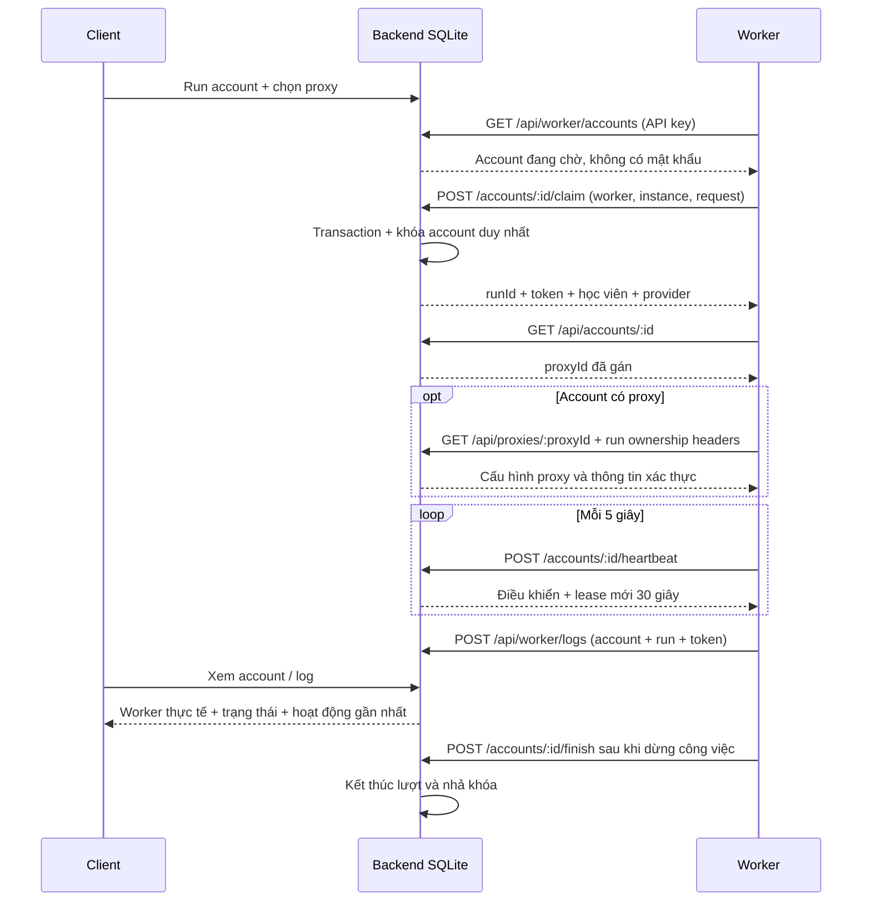

# Hàng chờ học viên và Worker tiếp nhận

Run/Treo đưa account vào hàng chờ (`status=running`). Backend không tạo tiến
trình .NET: Worker được khởi động riêng sẽ lấy học viên qua API. Worker V2 chạy
nhiều lane song song; từng lane có tên, API key và instanceId riêng, rồi tiếp
tục polling sau mỗi lượt.



## Đăng ký và cấu hình

Client API phải có `WORKER_REGISTRATION_KEY` là secret ngẫu nhiên tối thiểu 32
ký tự. Worker V2 cấu hình cùng secret trong `Worker:RegistrationApiKey`.
Endpoint `POST /api/workers` yêu cầu khóa bootstrap đó; thiếu hoặc sai khóa sẽ
bị từ chối. Không cấu hình khóa ở Client API thì endpoint đăng ký bị tắt.

Worker V2 tự đăng ký tên `WorkerName-01` đến
`WorkerName-<MaxConcurrentAccounts>` lúc khởi động. Lane mới trả HTTP 201; đăng
ký lại có xác thực trả HTTP 200 và cùng API key lane. Backend lưu các API key
trong `client/data/worker-api-keys.json`; Worker nhận từng key trong bộ nhớ và
dùng key riêng cho các request hàng đợi. Không cần khai báo `LaneApiKeys` hoặc
đăng ký lane thủ công. Nếu Worker ở máy khác, cấu hình địa chỉ backend và HTTPS.
Mọi `/api/worker/*` cần
`Authorization: Bearer <apiKey>`; backend lấy tên Worker từ API key.

```text
Client__Enabled=true
Client__BaseUrl=http://127.0.0.1:3100
Client__WorkerName=worker-node-01
Client__ApiKey=<apiKey>
Client__AccountId=
```

Bỏ trống AccountId để nhận tự động; đặt UUID để chỉ nhận một học viên. Chọn
`Worker__Mode=ReadOnlyProbe`, `AutoStudy` hoặc `PracticeOnly` theo công việc.
Với `dotnet run`, dùng `--no-launch-profile` nếu muốn biến môi trường thay cho
profile Idle. Thông tin LMS, GUID thiết bị và proxy lấy từ claim, không cần nhập
lại căn cước/mật khẩu trong .NET. `Client__Enabled=false` giữ chế độ độc lập.

## Danh sách và xác nhận tiếp nhận

`GET /api/worker/accounts?page=1&pageSize=20&accountId=<UUID tùy chọn>` trả
`data` và `pagination`, chỉ account đã Run, chưa có lượt hoạt động và proxy còn
bật/còn hạn hoặc kết nối trực tiếp. Không trả mật khẩu/token. Tên Worker nhập ở
account trước đó không giới hạn người được nhận; claim ghi tên Worker thực tế.

Sau khi claim thành công, Worker gọi `GET /api/accounts/:accountId` để đọc
`proxyId`. Nếu account được gán proxy, Worker tiếp tục gọi
`GET /api/proxies/:proxyId` với API key và các header sở hữu lượt:
`X-Worker-Account-Id`, `X-Worker-Run-Id`, `X-Worker-Instance-Id`,
`X-Worker-Lease-Token`. Backend chỉ trả thông tin xác thực proxy khi lượt còn
hoạt động và proxy đó thuộc account đang claim. Gọi endpoint proxy không có
ownership hợp lệ bị từ chối; request giao diện tiếp tục chỉ nhận dữ liệu đã ẩn
mật khẩu.

`POST /api/worker/accounts/:accountId/claim`:

```json
{
  "workerName": "worker-node-01",
  "instanceId": "11111111-1111-4111-8111-111111111111",
  "requestId": "22222222-2222-4222-8222-222222222222"
}
```

Response 200 minh họa:

```json
{
  "data": {
    "accountId": "33333333-3333-4333-8333-333333333333",
    "workerName": "worker-node-01",
    "instanceId": "11111111-1111-4111-8111-111111111111",
    "runId": "44444444-4444-4444-8444-444444444444",
    "leaseToken": "<token bí mật của lượt chạy>",
    "state": "accepted",
    "status": "running",
    "serverTime": "2026-10-21T08:00:00.000Z",
    "leaseExpiresAt": "2026-10-21T08:00:30.000Z",
    "provider": "truongson",
    "credentials": {
      "username": "000000000001",
      "password": "example-password",
      "deviceUuid": "55555555-5555-4555-8555-555555555555"
    },
    "lms": {
      "tenant": "truongson",
      "origin": "https://truongson.huelms.com",
      "base": "https://staging-api.lotuslms.com"
    },
    "proxy": null
  }
}
```

Claim có proxy snapshot để xác thực lựa chọn account; cấu hình sử dụng được đọc
từ `GET /api/proxies/:proxyId`. API UI không trả thông tin xác thực. Mất response phải retry cùng
instanceId và requestId để nhận cùng run/token. Claim dùng BEGIN IMMEDIATE và
partial unique index: mỗi account và mỗi instance chỉ có một lượt hoạt động,
kể cả hai instance có chung workerName. Worker khác nhận trùng bị từ chối.

## Heartbeat và kết thúc

`POST /api/worker/accounts/:accountId/heartbeat`:

```json
{
  "runId": "44444444-4444-4444-8444-444444444444",
  "instanceId": "11111111-1111-4111-8111-111111111111",
  "leaseToken": "<token từ claim>"
}
```

Response data gồm accountId, workerName, runId, state, status, serverTime,
leaseExpiresAt, proxy. Không trả lại credentials hoặc token. Heartbeat hợp lệ
chuyển accepted sang running và gia hạn 30 giây; gửi mỗi 5 giây. Status stopped
nghĩa là phải dừng công việc trước khi finish. `GET .../control` chỉ đọc, không
gia hạn, nhận quyền sở hữu qua header X-Worker-Run-Id, X-Worker-Instance-Id và
X-Worker-Lease-Token.

`POST /api/worker/accounts/:accountId/finish` nhận cùng ba trường sở hữu và
`outcome: "completed" | "failed" | "stopped" | "deferred" | "resting"`. Backend nhả khóa,
ghi log và với completed/failed/stopped thường chuyển account sang Dừng treo.
`deferred` giữ account ở trạng thái Treo và chọn ngẫu nhiên một thời điểm trong
khung **00:00:00–08:00:00 ngày hôm sau theo giờ Việt Nam**, chính xác đến giây.
Backend lưu thời điểm này vào `accounts.available_after` và trả qua
`execution.availableAfter`; account không thể được nhận trước lịch, kể cả claim
trực tiếp. Lane được nhận account khác trong thời gian đó. Lịch được giữ nguyên
khi khởi động lại hoặc gửi lại finish; lần đạt KPI ngày tiếp theo sẽ chọn lịch mới.
Nhấn Dừng treo rồi Treo lại sẽ xóa thời gian hoãn. Gửi lại cùng kết quả là idempotent.
Nhấn Dừng rồi Run lại khi Worker đang dừng vẫn giữ khóa cũ; finish mới nhả khóa
và giữ account trong hàng chờ cho lượt kế tiếp.

`resting` dùng riêng cho chu kỳ chạy/nghỉ, yêu cầu thêm `restSeconds` nguyên từ
60 đến 86400. Ví dụ payload (kèm quyền sở hữu hiện tại):

```json
{
  "runId": "<run UUID>",
  "instanceId": "<instance UUID>",
  "leaseToken": "<current ownership token>",
  "outcome": "resting",
  "restSeconds": 900
}
```

Backend lưu trạng thái lượt `deferred` và đặt `available_after` bằng thời điểm
finish cộng thời gian nghỉ. Response `data` có `runId`, `state="deferred"` và
`availableAfter`. `execution.deferReason` là `scheduled_break` cho kiểu nghỉ này,
`daily_kpi` cho lịch KPI. Trường `restSeconds` không được gửi với outcome khác.
Thiếu/sai duration trả 400; sai quyền sở hữu trả 403; retry khác outcome hoặc
duration trả 409 `RUN_OUTCOME_CONFLICT`. Retry đúng giữ nguyên cả thời điểm nghỉ
và log, không ghi lại lịch. Metadata của run được lưu trong
`worker_runs.finish_details_json` để giữ tính ổn định qua restart.

Nếu đã nhận lệnh Dừng hoặc Dừng rồi Run, finish không đặt lịch nghỉ và không
thay đổi ý định của người dùng; `availableAfter` trong receipt có thể null.
Đến hạn, account vào hàng chờ, vẫn cần một worker/lane đang chạy để nhận lại.
Worker V2 mặc định làm việc 180 phút từ lúc nhận, nghỉ ngẫu nhiên 900–1800 giây;
đổi các giới hạn qua cấu hình Worker/Docker Compose.

Không heartbeat đủ 30 giây: lượt được đánh dấu lost khi API tiếp theo kiểm tra,
account vẫn Treo được nhận lại. Token cũ không thể heartbeat hoặc finish lượt
mới. Worker .NET dùng đồng hồ monotonic để giới hạn lease và kiểm tra trước mỗi
request LMS; mất điều khiển hủy request đang chạy và dừng host. Cơ chế này dành
cho các Worker tuân thủ hợp đồng; LMS upstream không hỗ trợ fencing token để
backend thu hồi request đã được upstream nhận trước đó.

## Log và giao diện

`POST /api/worker/logs` giữ payload log trong API.md, thêm runId, instanceId,
leaseToken. Backend kiểm tra quyền sở hữu rồi lưu runId; token không được ghi
vào nội dung log. EventId giữ nguyên khi retry. Sau kết thúc/mất lease, cho gửi
nốt log tối đa 5 phút với đúng token của run cũ; log cũ không trở thành hoạt
động của lượt mới. API đọc log trả thêm runId để truy vết.

API account trả thêm execution gồm state, runId, workerName, lastHeartbeatAt,
leaseExpiresAt và lastLog `{message,level,occurredAt}` của đúng lượt mới nhất.
Bảng account và modal log tự cập nhật mỗi 5 giây. State hiển thị:

| State | Giao diện |
| --- | --- |
| queued | Chờ Worker |
| accepted | Đã tiếp nhận |
| running | Đang xử lý |
| stopping | Đang dừng |
| completed / failed / lost | Hoàn thành / Lỗi / Mất kết nối |

Run không đồng nghĩa Worker đã nhận. Khi còn lượt hoạt động, sửa account trả
409 ACCOUNT_BUSY; cần Dừng và chờ xác nhận hoặc hết lease. Thay đổi/tắt proxy
làm Worker dừng khi đọc heartbeat tiếp theo; proxy hết hạn không vào hàng chờ.

## Lỗi và nâng cấp

| HTTP / code | Xử lý |
| --- | --- |
| 401 WORKER_UNAUTHORIZED | Kiểm tra API key |
| 403 RUN_OWNERSHIP_MISMATCH | Dừng xử lý: sai Worker/instance/run/token |
| 403 WORKER_PROXY_MISMATCH | Chỉ lấy proxy được gán cho account đang sở hữu |
| 409 ACCOUNT_CLAIMED | Chọn account khác từ danh sách |
| 409 ACCOUNT_NOT_QUEUED | Account chưa Run hoặc đã dừng |
| 409 WORKER_INSTANCE_BUSY | Tiến trình đã nhận account khác |
| 409 CLAIM_CLOSED | Tải lại danh sách, tạo requestId mới |
| 409 LEASE_LOST | Dừng xử lý, không dùng token cũ nhận lại |
| 409 ACCOUNT_BUSY | Chờ lượt hiện tại dừng trước khi sửa |
| 409 PROXY_EXPIRED | Gia hạn/chọn proxy khác |

Schema 4 thêm worker_runs và worker_logs.run_id; sao lưu trước ALTER vào
`client/data/client.before-worker-queue.sqlite`. Dữ liệu cũ giữ nguyên, account
Treo chưa có claim được coi là đang chờ. Cần build lại Worker: control/log không
chấp nhận chỉ API key mà thiếu quyền sở hữu lượt. Kiểm thử dùng dữ liệu tạm,
Worker Idle và LMS giả lập, không chạy học viên thật.

## Chương trình học được chọn khi Run

Client có bước chọn chương trình học trước khi đưa account vào hàng chờ.
GET /api/worker/accounts, claim, heartbeat và control trả enrolmentPlanIid,
enrolmentPlanName; không còn trả courseIid, courseName. Mã lấy từ iid của
get-student-enrolment-plans. Account cũ chưa chọn trả null cho mã, chuỗi rỗng
cho tên. Schema 6 nâng cấp giữ mã chương trình đã lưu, không dùng tên khóa cũ.
SDK ClientAccount và ClientAssignment/ClientRunControl có thuộc tính tương ứng;
Worker đọc assignment.EnrolmentPlanIid và assignment.EnrolmentPlanName.
Luồng Worker V2 chưa được bổ sung thực thi chương trình trong thay đổi này.

## Worker V2 nhận việc

Worker V2 đã dùng SDK cho polling, claim, log, heartbeat và finish. Mỗi tiến
trình giữ một InstanceId, retry claim bằng cùng RequestId, retry log bằng cùng
EventId. Chỉ nhận account khác sau khi đã xác nhận kết thúc hoặc đối chiếu claim
cũ với backend. Nhận việc không đánh dấu completed; giai đoạn hiện tại giữ lease
chờ quy trình nghiệp vụ hoặc lệnh Dừng. Cấu hình và cách chạy: [Worker V2](../../LotusLMS.Worker.V2/README.md).
